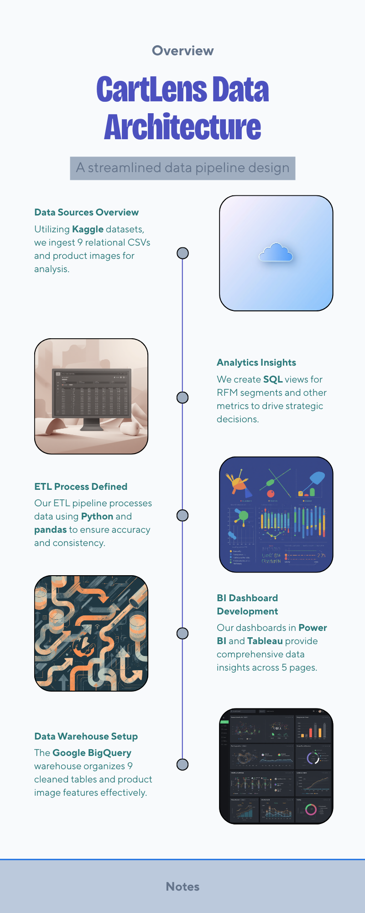
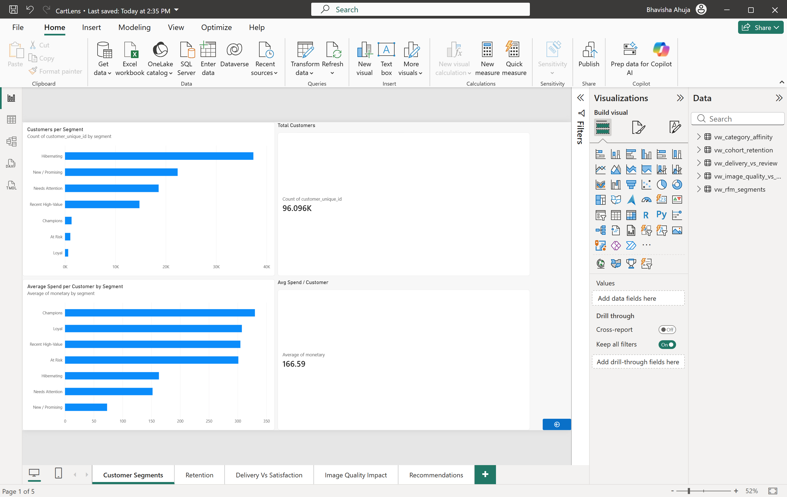
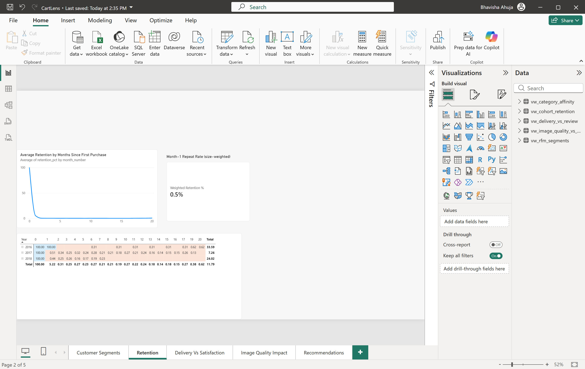
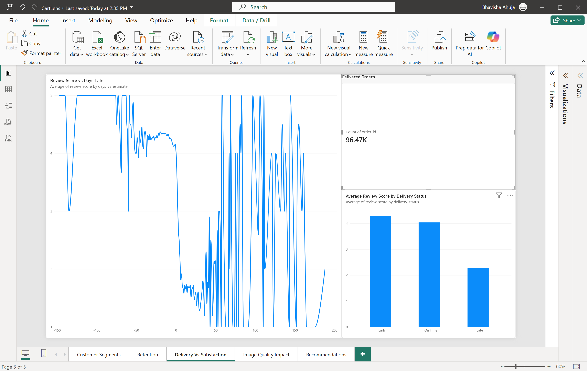
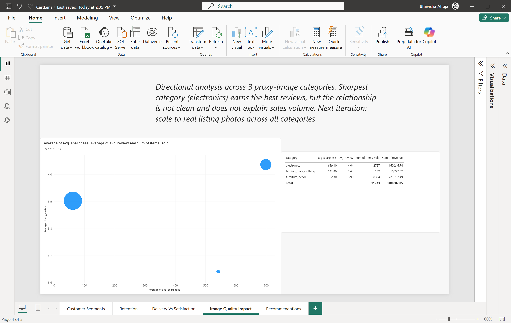
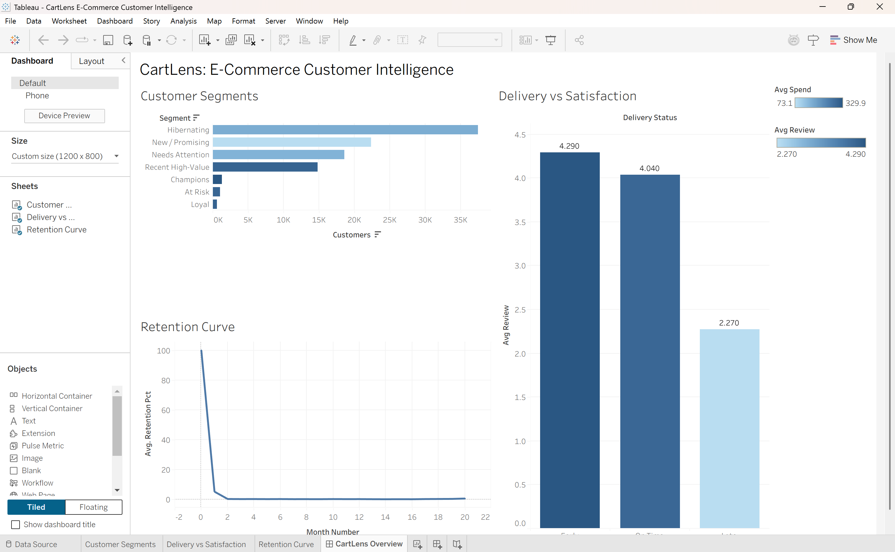

# CartLens: E-Commerce Customer Intelligence

An end-to-end analytics project on the Olist Brazilian e-commerce dataset, from raw CSVs to a cloud warehouse, a SQL analytics layer, and two BI dashboards. It also adds a computer-vision layer that turns product images into data and tests whether image quality relates to commercial outcomes.

**Stack:** Kaggle, Python (pandas, Pillow, scikit-learn), Google BigQuery, Google Cloud Storage, SQL, Power BI, Tableau.

**Live dashboards:** Power BI (5 pages) and a Tableau core dashboard. Screenshots below.

---

## Architecture



The design rule: structured data lives in BigQuery, image files live in a GCS bucket, and a lightweight `product_image_features` table links the two. Blobbing images into a warehouse is bad practice, so this split keeps the warehouse clean and the storage layer secure (the bucket has public access locked down).

The flow: pull 9 Olist CSVs plus a product-image set from Kaggle, clean and reshape them in a Python ETL step, extract image features in a separate CV script, load everything into BigQuery, express every business question as a reusable SQL view, then read those views into Power BI and Tableau.

---

## The findings

### 1. A small share of customers is worth far more per head

RFM segmentation (recency, frequency, monetary) splits ~96,000 customers into behavioral segments. Champions are only about 1,300 customers (roughly 1.4% of the base) but average ~330 in spend, while the largest segment, Hibernating (~37,000 customers), averages ~163. The valuable segments are rare, and they are worth roughly twice as much each.

**Recommendation:** build a loyalty program around Champions and Recent High-Value customers, with a win-back offer for At Risk buyers before they lapse.

### 2. Retention falls off a cliff after the first order

Grouping customers into monthly cohorts and tracking repeat purchases shows retention collapsing immediately. About 97% of customers order exactly once. Only ~3% ever place a second order at any point, and the size-weighted share that reorders within the first month is roughly 0.5%.

One analytical note worth flagging: the simple average of per-cohort retention rates reads ~5% at month one, but that is inflated by tiny early cohorts (a cohort of 3 people with 1 repeat looks like 33%). Weighting by actual cohort size corrects it down to ~0.5%. The dashboard shows the unweighted curve for the shape of the cliff and reports the weighted rate as the honest number.

**Recommendation:** the single biggest growth lever is converting one-time buyers to a second purchase. A post-purchase lifecycle (day-7 and day-30 follow-ups, replenishment reminders, a first-repeat incentive) targets exactly that.

### 3. Late delivery measurably hurts satisfaction

Comparing actual delivery against the promised estimate and joining to review scores gives the cleanest number in the project. Early orders average 4.29 stars, on-time 4.04, and late orders just 2.27. Lateness costs about two full stars, and the drop is monotonic (the later the order, the worse the score, bottoming out near 1.7).

A side insight: roughly 88,000 of ~96,000 orders arrive early and only ~1,280 land exactly on time, which means Olist deliberately pads its delivery estimates. That under-promise, over-deliver habit is doing real work protecting satisfaction.

**Recommendation:** treat on-time delivery as a satisfaction lever, not just logistics. Protect the early-delivery edge and flag shipments at risk of slipping late.

---

## Bonus insights

**Almost no cross-sell.** Over 99% of orders contain a single product category. Cross-category baskets barely exist, which is itself an opportunity: bundle within natural clusters (the home cluster of bed_bath_table, furniture_decor, and housewares is the obvious start).

**Image quality vs outcomes (computer vision layer).** A Python pipeline extracts brightness, sharpness (variance of the Laplacian), dominant color, and resolution from product images, then joins those features to sales and reviews. Across the categories tested, the sharpest category (electronics) also earns the best reviews, a directional positive signal. It is not a clean law though: blurry furniture still out-reviews mid-sharp fashion and sells the most by far, so sharpness does not explain sales volume. This is a proof of method on a small proxy image set (3 overlapping categories), and scaling it to real listing photos across all categories is the stated next iteration.

---

## Dashboards

### Power BI

| Page | What it shows |
|------|---------------|
| Customer Segments | RFM segment sizes and the spend gradient |
| Retention | Cohort retention cliff, a weighted-repeat-rate DAX measure, and a cohort heatmap |
| Delivery vs Satisfaction | Average review by delivery status and a days-late dose-response |
| Image Quality Impact | Sharpness vs reviews (bubble-sized by sales) with an honesty caveat |
| Recommendations | Findings translated into business actions |






### Tableau

The core story (segments, delivery, retention) rebuilt in Tableau to show range across both tools. Workbook is in `dashboards/`.



---

## How it is built

1. **Ingest.** Download the 9 Olist CSVs and a CC0 product-image set with the Kaggle CLI.
2. **Inspect.** A small peek script prints shapes, types, and null counts so cleaning decisions are made on evidence (for example, the nulls in orders are meaningful canceled or undelivered orders, so they are kept, not dropped).
3. **Clean (Python ETL).** Parse text timestamps into real dates, translate Portuguese category names to English, label missing categories as unknown, and dedupe geolocation to one row per zip prefix.
4. **Extract image features (Python CV).** Sample product images and compute brightness, sharpness, dominant color, and resolution into a features table.
5. **Warehouse.** Load all cleaned tables plus the features table into BigQuery, and upload image files to a GCS bucket.
6. **Analytics (SQL).** Five reusable views answer one business question each: RFM segments, cohort retention, delivery vs review, category affinity, and image quality vs outcomes.
7. **Visualize.** Power BI (Import mode, connected to BigQuery) and Tableau (on exported CSV summaries).

---

## Notes on data and honesty

- **Why Olist (a Brazilian dataset) for US-focused analysis.** Olist is the only public set with all the pieces this project needs (prices, order dates, delivery timestamps, reviews, and a product-image link) across nine relational tables. The methods transfer 1:1 to a US retailer, which is the stated next step.
- **The image layer is a proxy.** Olist ships no real product-image files, so a small overlapping image set stands in as a proof of method. The finding is framed as directional, not a broad statistical claim.
- **Retention is reported size-weighted.** See Finding 2. The point is to report the defensible number, not the flattering one.

---

## Repo structure

```
CartLens/
  data/            raw and cleaned data (raw CSVs gitignored)
  etl/             ETL notes
  scripts/         peek, ETL clean, image feature extraction, BigQuery load
  sql/             the 5 analytics views + verification queries
  dashboards/      CartLens.pbix, Tableau workbook, exported CSV summaries
  images/          architecture diagram + dashboard screenshots
  README.md
```

---

## Next iterations

- Scale the image analysis to real listing photos across all categories.
- Add a larger public dataset (for example theLook) for a big-data variant.
- Rebuild the Python ETL as a visual Alteryx workflow for a second ETL proof.
- Apply the same pipeline to a US retail dataset.

---

## About

Built by Bhavisha Ahuja. Chicago, IL.
[LinkedIn](https://www.linkedin.com/in/bhavisha-ahuja180503/) · [GitHub](https://github.com/Bhavishaahuja)
